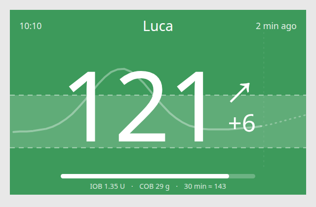
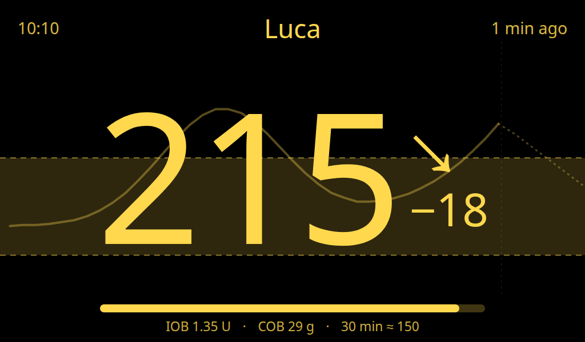

# Nightscout Extended for Home Assistant

Brings the values Nightscout already calculates into Home Assistant: **insulin on board, carbs on board, the AR2
glucose forecast**, current basal, and the latest glucose with its trend. Home Assistant's built-in Nightscout
integration only provides glucose. This one can run alongside it.

> [!WARNING]
> **Not a medical device. Don't make treatment decisions from it.** Values are read from your Nightscout site and
> can be late, missing or wrong. IOB and COB are only as accurate as the treatments logged in Nightscout and the
> profile settings it calculates them from. The AR2 forecast is a short statistical extrapolation, not a prediction
> of what insulin or food will do. Always confirm with your meter, CGM app or pump.

## Sensors

| Sensor | Unit | Notes |
|---|---|---|
| Glucose | mg/dL or mmol/L | Follows your Nightscout's unit setting; attributes `direction`, `delta`, `thresholds_mgdl` (your site's alarm levels) |
| Glucose change | mg/dL or mmol/L | Change since the previous reading |
| Glucose trend | – | Rising quickly … Falling quickly |
| Last reading | timestamp | When the latest CGM value was taken |
| Insulin on board | U | Nightscout `iob` plugin; attribute `source` (e.g. Care Portal, Loop, OpenAPS) |
| Carbs on board | g | Nightscout `cob` plugin |
| Forecast in 15 minutes | mg/dL or mmol/L | Nightscout `ar2` plugin |
| Forecast in 30 minutes | mg/dL or mmol/L | Attribute `forecast` holds the whole predicted curve |
| Last carbs | g | Most recent treatment with carbs; attributes `time`, `event_type`, `notes` |
| Last insulin | U | Most recent treatment with insulin; same attributes |
| Current basal | U/h | Disabled by default; enable it if you use a pump |

## Treatments calendar

`calendar.<site>_treatments` shows every Nightscout treatment as an event: meals, boluses, notes, temporary
targets, and anything logged for a **future** time. The summary reads like `Meal Bolus: 30 g carbs`,
`Correction Bolus: 0.5 U insulin`, or the first line of a note. The full note is in the event description.

### Example: an alarm before a planned meal

Log a note at the meal's time in Nightscout (or let an app do it; Kitchen Carbs sends planned meals as
`Planned meal: …` notes). A calendar trigger fires at the event's start, or a set time before it:

```yaml
automation:
  - alias: Mealtime reminder
    triggers:
      - trigger: calendar
        event: start
        entity_id: calendar.nightscout_treatments
        offset: "-0:10:00"   # 10 minutes before
    conditions:
      - condition: template
        value_template: "{{ trigger.calendar_event.summary.startswith('Planned meal') }}"
    actions:
      - action: notify.notify
        data:
          title: Mealtime in 10 minutes
          message: "{{ trigger.calendar_event.summary }}"
```

Home Assistant checks calendars for upcoming events every 15 minutes, so a reminder for something logged less than
15 minutes ahead may be skipped.

> Log future meals as **notes**, not with carbs filled in. Nightscout counts carbs and insulin from the
> treatment's time onwards whether or not they happened, so a planned meal with carbs would show up in COB and the
> forecast if it's skipped.

A sensor shows *unknown* when its Nightscout plugin is off. Enable `iob`, `cob`, `ar2` and `basal` in Nightscout's
`ENABLE` setting to get them all.

## Glucose card

The integration comes with a glanceable glucose display for a kitchen tablet, a bedside screen or any dashboard.
It loads automatically: there's no resource to add. In a dashboard, **Add card → Nightscout Glucose**, or:

```yaml
type: custom:nightscout-glucose-card
name: Sam
```

| Day | Night (coloured text on black) |
|---|---|
|  |  |

- **Big reading, trend arrow and change**, with how long ago it was taken and a bar that empties as it gets older.
- **Coloured by your Nightscout alarm levels** (`BG_LOW`, `BG_TARGET_BOTTOM`, `BG_TARGET_TOP`, `BG_HIGH`): urgent
  low, low, in range, high, urgent high. Grey with a warning once there's been no reading for 15 minutes.
- **Chart behind the number**: recent readings, the target range, and the AR2 forecast as a dotted line.
- **Night mode** from 21:00 to 07:00 by default.
- **IOB, COB and the 30-minute forecast** along the bottom.
- mg/dL or mmol/L, following the sensor's unit.

It finds the integration's sensors itself; set `entity` if you have more than one Nightscout site.

| Option | Default | |
|---|---|---|
| `entity` | found automatically | The *Glucose* sensor of the site to show |
| `name` | none | Text at the top, e.g. whose readings these are |
| `fill_screen` | `false` | Fill the screen from the card's top edge down, for a panel view on a kiosk (works with the header hidden) |
| `hours_to_show` | `3` | Hours of history in the chart (1–48) |
| `show_chart`, `show_footer`, `show_clock` | `true` | Turn parts off |
| `night_mode` | `true` | Dim to coloured text on black at night |
| `night_start`, `night_end` | `21`, `7` | Night hours (0–23) |
| `stale_minutes` | `15` | Minutes without a reading before the card turns grey |

For a full-screen display, put the card alone in a **panel** view and set `fill_screen: true`.

> The card shows what Home Assistant last read from Nightscout. It is not an alarm: it makes no sound and can't
> tell you about readings Home Assistant hasn't received. Keep your CGM app's alerts on.

## Installation

**Marketplace (HACS):** search for *Nightscout Extended* and install. Until it's in the default list, add this
repository with **Add from link** (or *Custom repositories*, category *Integration*).

**Manual:** copy `custom_components/nightscout_extended` into your Home Assistant `config/custom_components/` folder.

Restart Home Assistant, then go to **Settings → Devices & services → Add integration → Nightscout Extended**.

## Setup

- **URL**: your Nightscout address, e.g. `https://mysite.example.com`.
- **Access token or API secret**: create a token in Nightscout under **Admin tools → Subjects** with the
  **readable** role and paste it here. The API secret works too, but it gives full write access, so a read-only
  token is safer. Leave it empty if your site is publicly readable.

The update interval (default 60 s) can be changed under the integration's **Configure** button.

## Example: forecast chart

The `forecast` attribute is a list of `{time, mgdl}` points, which you can plot with e.g. ApexCharts card:

```yaml
type: custom:apexcharts-card
graph_span: 3h
span: { end: hour, offset: +1h }
series:
  - entity: sensor.nightscout_glucose
  - entity: sensor.nightscout_forecast_in_30_minutes
    name: Forecast
    data_generator: |
      return entity.attributes.forecast.map(p => [new Date(p.time).getTime(), p.mgdl]);
```

## Development

```bash
uv run --with pytest --with aiohttp pytest tests -q                       # parsing and auth
uv run --python 3.14 --with pytest-homeassistant-custom-component \
  pytest tests_ha -q -c tests_ha/pytest.ini -p no:cacheprovider          # inside Home Assistant
node --test tests_js/*.test.mjs                                           # glucose card logic
```

The card is a single dependency-free file, `custom_components/nightscout_extended/www/nightscout-glucose-card.js`.
Its `CARD_VERSION` must match `manifest.json` (a test checks this); the version is part of the URL Home Assistant
loads it from, so browsers fetch the new card after an update.

### Releasing

1. Add a section for the new version at the top of `CHANGELOG.md` and bump `version` in `manifest.json` and
   `CARD_VERSION` in the card.
2. Commit, then tag and push: `git tag v0.3.0 && git push origin main v0.3.0`.

The *Release* workflow checks that the tag matches `manifest.json`, then publishes the release with that
version's changelog section as its notes (which Home Assistant shows in the update dialog).
